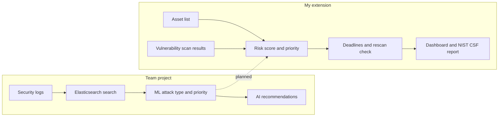

# SOC Dashboard: Which Security Problems Should We Fix First?

A dashboard that looks at **security logs** and **vulnerability scan results**, and helps a security team decide which vulnerabilities to fix first, check that fixes really happened, and report progress.

---

## 1. Team project (CSE 543, Arizona State University)

Our team built an **AI-powered security incident reporting tool** for analyzing security logs:

- **Log generator:** creates over a million realistic security log events (logins, failed logins, privilege escalation attempts, malware detections, data exfiltration alerts) across nine services
- **Search with Elasticsearch:** stores the logs and lets you filter them by date, time, and keyword in a Streamlit web app
- **Severity overview:** charts showing how many events are CRITICAL, ERROR, WARNING, or INFO over time
- **Machine learning tagging:** a model trained on 5,000 labeled log messages tags each event with an **attack type** (e.g. Brute Force, Privilege Escalation, Malware) and a **priority** (High, Medium, Low)
- **AI recommendations:** for high-priority events, a local AI model (Gemma 3 through Ollama) suggests the **NIST CSF function**, **MITRE ATT&CK tactic**, attack vector, and a recommended action. Everything runs locally, so log data never leaves the machine.

## 2. What I built on top of it

The team project answers *"What is happening in our logs?"* I extended it to answer the next question a security team faces:

> *We have hundreds of vulnerabilities. Which ones matter most, and are they actually getting fixed?*

### Ranks vulnerabilities by real risk, not just severity
Every vulnerability has a severity score (CVSS), but that alone isn't enough. A "critical" flaw on a test server nobody uses is less urgent than a "high" flaw on a payment system attackers are already exploiting. The dashboard combines several signals into one risk score:

| Signal | Points |
|---|---|
| How severe is it? (CVSS) | CVSS × 4 |
| Are attackers using it right now? (CISA Known Exploited Vulnerabilities list) | +25 |
| How likely is it to be exploited soon? (EPSS) | +5 / +10 |
| How important is the system? | 0 – 15 |
| Can anyone on the internet reach it? | +10 |
| Does it hold regulated data (student records, health, payment, research)? | +5 |

Each finding gets a priority from **P1** (fix within 7 days) to **P4** (fix within 90 days), and the dashboard shows **why**, e.g. *CVSS 8.8 (+35.2); Known exploited (+25); Critical asset (+15); PCI data (+5)*.


*The purple "ATT&CK correlation" piece in the chart is planned (see Future work).*

### Tracks deadlines and checks that fixes really happened
Deadlines are counted from when each vulnerability was first found, and overdue items are flagged. A ticket marked "fixed" isn't proof: if the latest scan still finds the vulnerability, the dashboard reopens it as **Not Verified**. The ticket is a claim; the scan is the evidence.

### Reports to leadership using the NIST Cybersecurity Framework
One click downloads an Excel report organized by NIST CSF 2.0 functions:

| Sheet | What's in it |
|---|---|
| Executive Summary | Open findings, P1s, actively exploited, past deadline, not verified, inventory gaps |
| Govern | Deadline policy by priority; open and overdue findings per system owner |
| Identify | Priority breakdown; devices missing from the inventory; systems not scanned in 30+ days; systems with no owner |
| Protect | Overdue findings; closed tickets still detected on the latest scan |
| Detect | Planned |
| Respond / Recover | Points to the AI-recommended incident actions from the team project |

### Realistic sample data
A generator creates about 50 servers and 230 vulnerability findings across university departments. It deliberately includes common real-world problems (devices missing from the inventory, systems nobody owns, tickets closed without a real fix) so the dashboard and report have something to find.

### Smaller improvements to the team project
- The AI prompt now uses all six **NIST CSF 2.0** functions, including the new **Govern** function
- The log generator takes command-line options (`--count`, `--out`, `--seed`) instead of a hard-coded path

## 3. Future work

- **Connect logs to vulnerabilities:** when the logs show a burst of a certain kind of attack on a service (for example, privilege escalation attempts on the payment service), raise the priority of vulnerabilities on that service that enable the same kind of attack, matched through MITRE ATT&CK tactics. This also fills the report's Detect section.
- **Exception review:** check that every accepted risk is approved, time-limited, and backed by a compensating control
- **Control assessment:** rate controls (inventory, scanning coverage, remediation within deadline) as effective or not, with a crosswalk to NIST 800-53, ISO 27001, PCI DSS, and HIPAA
- **System-owner emails:** a ready-to-edit remediation notice for each owner listing what to fix and by when
- **Real threat data:** load the live CISA KEV catalog and FIRST EPSS scores instead of sample values

---

## How it works



## Run it

**Vulnerability dashboard only:**
```bash
pip install streamlit pandas openpyxl
python project-root/tools/generate_sample_data.py   # create sample data
cd project-root/app
streamlit run main.py
```
Open http://localhost:8501 and choose **Vulnerability Risk** in the sidebar.

**Full project including log analysis:** install [Docker Desktop](https://www.docker.com/products/docker-desktop/) and [Ollama](https://ollama.com/download) (`ollama pull gemma3:1b`), then run `docker-compose up --build` in `project-root`.

## Built with
Python · pandas · Streamlit · Elasticsearch · scikit-learn · Ollama (Gemma 3) · Docker

## Key terms

| Term | Meaning |
|---|---|
| **CVSS** | A 0–10 score for how severe a vulnerability is |
| **CISA KEV** | A U.S. government list of vulnerabilities attackers are actively exploiting |
| **EPSS** | The estimated probability a vulnerability will be exploited in the next 30 days |
| **MITRE ATT&CK** | A catalog of attacker techniques and tactics |
| **NIST CSF** | A widely used framework for organizing a security program (Govern, Identify, Protect, Detect, Respond, Recover) |

*All hosts, people, and tickets in the sample data are made up.*
