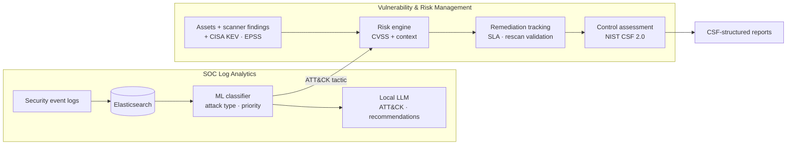

# SOC Dashboard: Risk-Based Vulnerability & Security Log Analytics


## Background

**The original project:** an AI-powered security incident reporting tool built as a team project for CSE 543 at Arizona State University. It ingests 1M+ simulated security event logs into Elasticsearch, classifies each event by attack type and priority with machine learning, and uses a local LLM to map high-priority events to MITRE ATT&CK and NIST CSF with recommended actions.

**What I'm extending it into:** a **risk-based vulnerability management and GRC reporting tool** that connects those SOC detections to vulnerability data.

| | Original | Extension |
|---|---|---|
| **Focus** | Detecting and triaging security events | Deciding what to fix first and proving it got fixed |
| **Prioritization** | ML priority per log event | Risk score per vulnerability: CVSS + CISA KEV + EPSS + asset context |
| **MITRE ATT&CK** | Tags log events | Links vulnerabilities to detections on the same service |
| **NIST CSF** | Labels each incident | Structures the dashboard, control assessment, and reports |
| **Output** | Tagged log CSV | Remediation tracking, control assessment, stakeholder reports |

---

## Architecture



---

## Risk-Based Prioritization

CVSS says how severe a flaw is in theory. It doesn't say whether attackers are exploiting it or whether the system matters. The risk engine starts from CVSS and adds context:


| Factor | Points |
|---|---|
| CVSS base score | CVSS × 4 (max 40) |
| Listed in CISA KEV (exploited in the wild) | +25 |
| EPSS probability ≥ 0.1 / ≥ 0.5 | +5 / +10 |
| Asset criticality (Low → Critical) | 0 – 15 |
| Internet-facing | +10 |
| Regulated data (FERPA, HIPAA, PCI, CUI) | +5 |
| Matching ATT&CK activity in SOC logs | +10 |

**P1** ≥ 80 (fix in 7 days) · **P2** ≥ 60 (30 days) · **P3** ≥ 40 (60 days) · **P4** (90 days)

Every finding carries a plain-language rationale, e.g. `CVSS 7.5 (+30); KEV (+25); Internet-facing (+10); PCI data (+5) → P1`, so the priority can be explained to the system owner who has to fix it.

---

## Threat-Informed Correlation (MITRE ATT&CK)

Vulnerabilities are mapped to the ATT&CK technique an attacker would use (e.g. PrintNightmare → T1068 *Exploitation for Privilege Escalation*). ML-classified log events are mapped to tactics (e.g. *Privilege Escalation* → TA0004). When **the same service** shows both, the finding is escalated: the weakness exists *and* someone is already trying that kind of attack.

---

## Remediation & GRC Checks

- **SLA tracking:** due dates, overdue items, and roll-ups by system owner
- **Rescan validation:** a ticket closed as *Remediated* but still detected on the latest scan is flagged *Not Verified*
- **Inventory reconciliation:** unmanaged hosts, scan coverage gaps, assets with no owner, retired assets still on the network
- **Exception review:** expired, unapproved, or missing a compensating control
- **Control assessment:** six controls rated *Effective / Partially / Not effective* from evidence, mapped to NIST CSF 2.0 with a crosswalk to NIST 800-53, ISO 27001, PCI DSS, HIPAA, and CMMC ([full mapping](docs/control_crosswalk.md))

---

## Dashboard

The vulnerability dashboard follows **NIST CSF 2.0 functions**, so screens and reports share one structure.

| Tab | Shows |
|---|---|
| Overview | Key metrics; CVSS vs. risk score |
| Govern | SLA policy, exception review, control assessment |
| Identify | Inventory reconciliation, prioritized findings |
| Protect | Remediation status, rescan validation |
| Detect | ATT&CK correlation with SOC detections |
| Report | CSF-structured Excel report, system-owner notices |

---

## Getting Started

```bash
# 1. Local LLM (enable "Expose Ollama to the network" in Ollama settings)
ollama pull gemma3:1b
ollama serve

# 2. App + Elasticsearch
cd project-root
docker-compose up --build
```
Open http://localhost:8501. The vulnerability dashboard runs on bundled synthetic data, even without Elasticsearch.

---

## Notes
- Sample hosts, owners, tickets, and scores are **synthetic**.
- The LLM runs **locally** through Ollama, so no log or vulnerability data is sent to an external AI service.
