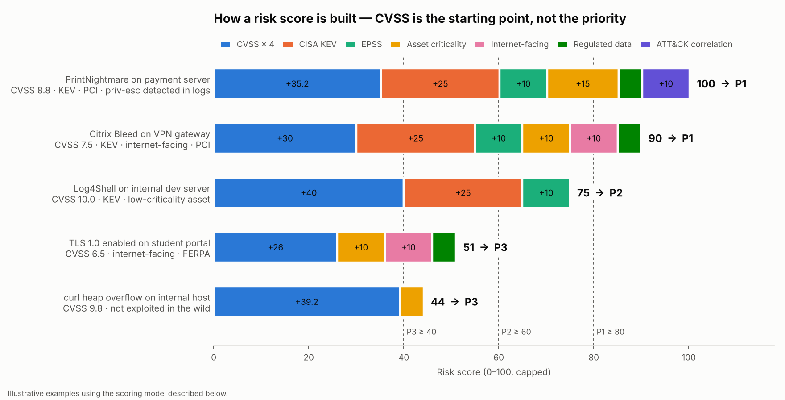
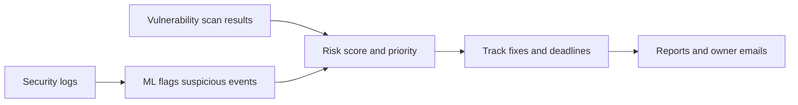

# SOC Dashboard: Which Security Problems Should We Fix First?

A dashboard that looks at **security logs** and **vulnerability scan results** together, and helps a security team decide what to fix first, check that fixes really happened, and report progress.

## Background

This started as a team project for CSE 543 at Arizona State University: a tool that reads over a million security log events, uses machine learning to flag suspicious ones, and asks a local AI model for recommended actions.

I extended it to answer a practical question security teams face every week:

> *We have hundreds of vulnerabilities. Which ones matter most, and are they actually getting fixed?*

## What it does

### 1. Ranks vulnerabilities by real risk, not just severity
Every vulnerability has a severity score (CVSS), but that score alone isn't enough. A "critical" flaw on a test server nobody uses is less urgent than a "high" flaw on a payment system that attackers are already exploiting.

The dashboard combines several signals into one risk score:



- **How severe is it?** (CVSS score)
- **Are attackers using it right now?** (CISA's Known Exploited Vulnerabilities list)
- **How important is the system?** (e.g. payment or student-records systems score higher)
- **Can anyone on the internet reach it?**
- **Do our logs show attacks of that kind on that system?**

Each finding gets a priority from **P1** (fix within 7 days) to **P4** (fix within 90 days), with a one-line explanation of why.

### 2. Connects logs to vulnerabilities
If the logs show a burst of password-guessing attempts on the web servers, and those same servers have a weak-login vulnerability, the dashboard raises its priority. The flaw exists *and* someone is already trying that kind of attack.

### 3. Checks that fixes really happened
A ticket marked "fixed" isn't proof. If the next scan still finds the vulnerability, the dashboard flags it as **Not Verified**.

### 4. Finds gaps in the bigger picture
- Devices on the network that aren't in the official inventory
- Systems that haven't been scanned recently
- Systems with no owner to fix them
- Approved exceptions that have expired

### 5. Reports progress
- A one-click **Excel report** for leadership, organized by the NIST Cybersecurity Framework
- A ready-to-edit **email for each system owner** listing what to fix and by when

## How it works



## Run it

You need [Docker Desktop](https://www.docker.com/products/docker-desktop/). For AI recommendations, also install [Ollama](https://ollama.com/download).

```bash
cd project-root
docker-compose up --build
```

Open http://localhost:8501 and choose **Vulnerability Risk** in the sidebar. It works right away with the included sample data.

## Built with
Python · Streamlit · Elasticsearch · scikit-learn · Ollama (Gemma 3) · Docker

## Key terms

| Term | Meaning |
|---|---|
| **CVSS** | A 0–10 score for how severe a vulnerability is |
| **CISA KEV** | A U.S. government list of vulnerabilities attackers are actively exploiting |
| **MITRE ATT&CK** | A catalog of attacker techniques, used here to match log activity to vulnerabilities |
| **NIST CSF** | A widely used framework for organizing a security program (Govern, Identify, Protect, Detect, Respond, Recover) |

*All hosts, people, and tickets in the sample data are made up.*
